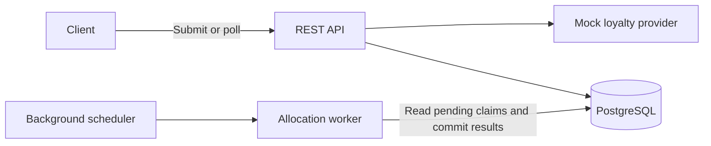

# Voucher Issuance Architecture



The service uses one Spring Boot application and PostgreSQL. The API stores claims durably; a background worker allocates vouchers after each collection window closes. PostgreSQL holds the queue, inventory, and final results, so application instances share the same state.

## Components

| Package | Responsibility |
| --- | --- |
| `campaign` | Create campaigns and expose inventory. |
| `claim` | Accept claims, handle retries, and return results. |
| `allocation` | Manage time windows and allocate vouchers. |
| `loyalty` | Provide server-controlled mock loyalty scores. |
| `common` | Configuration, security, errors, and database time. |

Spring JDBC makes queries and locks explicit. Flyway creates the schema. PostgreSQL provides durable storage and coordination without a separate cache or message broker.

## Request flow

1. An admin creates a campaign with a fixed total capacity and collection window.
2. A user submits a claim. An existing `(campaignId, userId)` returns its original request and current result.
3. The API reads the mocked loyalty score and saves a `PENDING` claim in the current window using a short transaction. It returns `202 Accepted` only after the claim commits.
4. After closure, a worker processes the campaign's earliest unfinished window. It ranks all pending claims by loyalty, issues the remaining vouchers, and rejects unsuccessful claims with `SOLD_OUT`.
5. Voucher records, claim results, inventory, and window completion commit together. The client polls the result endpoint.

```text
PENDING -> ISSUED   (includes voucherCode)
PENDING -> REJECTED (includes reason: SOLD_OUT)
```

## Priority and batching

“Simultaneous” means **admitted into the same fixed time window**, measured using PostgreSQL time. Windows start at the campaign's `startsAt`. Membership is checked during admission, so client send time alone does not determine the window.

Within a closed window, ordering is:

```sql
ORDER BY loyalty_points_snapshot DESC, accepted_at ASC, id ASC
```

The score is stored on first admission. The mock defaults to `CRC32(UTF-8 userId) % 10000` and supports server-side fixture scores. Clients cannot supply loyalty points.

For **20 users, 5 vouchers, and a 500 ms window**, all 20 claims admitted during that window compete together. The worker waits for closure, then issues to the top five by loyalty and rejects the other 15.

| Setting | Default | Meaning |
| --- | --- | --- |
| Collection window | 500 ms | Defines which requests compete; configurable from 100 to 10,000 ms. |
| Processing chunk size | 500 | Bounds each database operation; configurable from 1 to 10,000 requests. |

With 12 remaining vouchers and chunk size 5, the globally ranked top 12 win in chunks of 5, 5, and 2. All chunks belong to one transaction. Reaching the chunk size never closes a window early.

Windows consume inventory in chronological order. A higher-scoring user in a later window cannot replace an earlier winner. Capacity is a campaign lifetime limit and never resets. Ranking the entire campaign together would require waiting for a registration deadline before issuing any vouchers.

## Data and concurrency

| Table | Stores |
| --- | --- |
| `campaign` | Capacity, issued count, schedule, and window duration. |
| `claim_batch` | Window boundaries and completion state. |
| `claim_request` | User, loyalty snapshot, window, and result. |
| `voucher` | The unique code issued to a successful claim. |

**Duplicate prevention.** Unique `(campaign_id, user_id)` constraints enforce one claim and one voucher per user per campaign. Concurrent retries return the same logical request. Voucher codes also have a unique constraint.

**Inventory protection.** Allocation locks the campaign row, so only one worker allocates that campaign at a time. It reads remaining inventory under that lock and uses a guarded counter update. A database check keeps `issued_count` between zero and capacity.

**Complete window ranking.** Admissions hold compatible `FOR SHARE` locks on the window row. Allocation takes `FOR UPDATE`, waits for in-flight admissions, then ranks using a fresh `READ COMMITTED` query. Admissions reaching an expired window retry against the current one. Window catalog rows commit separately before admission so workers can discover earlier windows.

**Multiple instances.** Workers lock the campaign with `FOR NO KEY UPDATE SKIP LOCKED`, then its earliest unfinished window without skipping it. PostgreSQL coordinates all instances, preserving inventory and chronological window order.

## Failures and tradeoffs

- Allocation failure rolls back the entire window, including earlier chunks. Claims remain pending for a worker to retry.
- Accepted claims survive an application restart in PostgreSQL. Workers discover unfinished windows when they resume.
- Transient database failures during admission return a retryable `503` if the claim cannot commit. Retrying with the same user and campaign is safe.
- Results wait for window closure and worker availability. Under load, resolution can take longer than one window.
- A campaign allocates sequentially; different campaigns can run concurrently. Smaller chunks bound individual operations and memory use, but do not shorten the whole transaction.

## Verification

The suite contains **17 HTTP integration cases and 7 configuration cases**. It uses real PostgreSQL and covers loyalty ranking, duplicate claims, capacity limits, validation, two application instances, and rollback after a failure following the first processing chunk.

`make smoke` checks the top-five result for 20 concurrent users in one window. It uses a 5-second window to keep the demonstration stable across machines; the application default remains 500 ms. Load runs also accepted 5,000 claims, with measured latency limits recorded in [Verification results](VERIFICATION.md).

For exact API contracts, SQL, and implementation steps, see the [detailed specification](TECH_SPEC.md).
