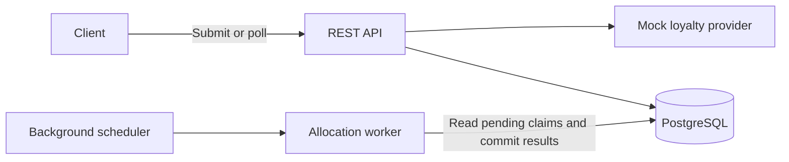
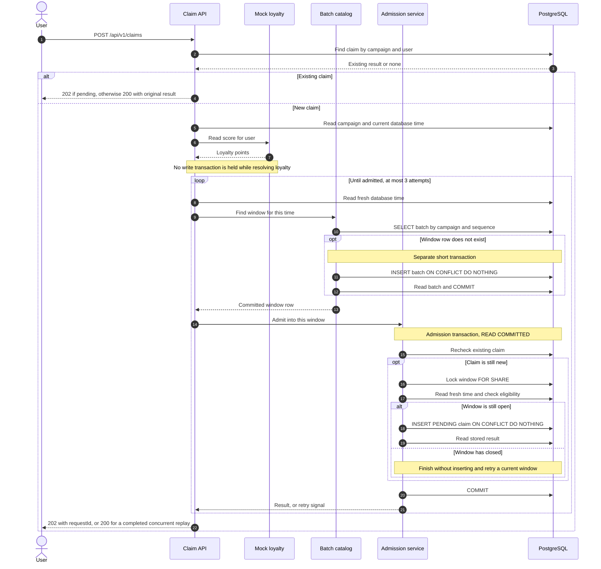
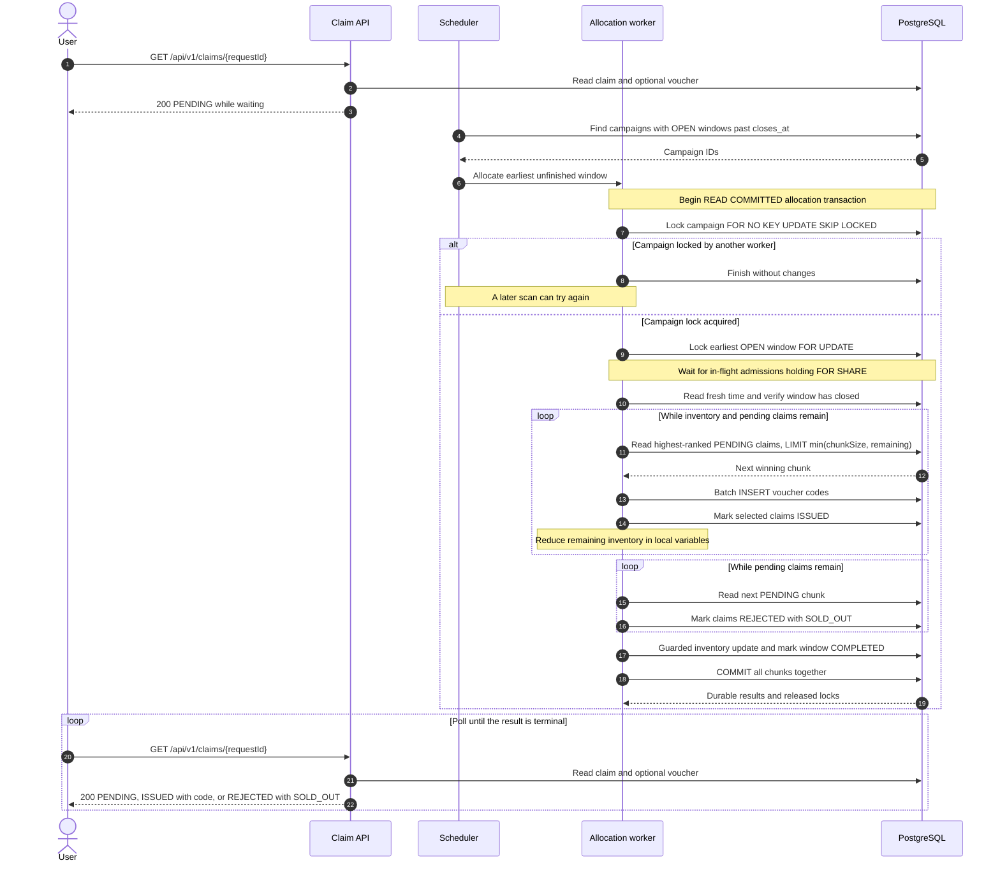

# Voucher Issuance Architecture



The service uses one Spring Boot application and PostgreSQL. The API stores claims durably; a background worker allocates vouchers after each collection window closes. PostgreSQL holds the queue, inventory, and final results, so application instances share the same state.

## Components

| Package | Responsibility |
| --- | --- |
| `campaign` | Create campaigns and expose inventory. |
| `claim` | Accept claims, handle retries, and return results. |
| `allocation` | Manage time windows and allocate vouchers. |
| `loyalty` | Provide server-controlled mock loyalty scores. |
| `common` | Configuration, security, errors, and database time. |

Spring JDBC makes queries and locks explicit. Flyway creates the schema. PostgreSQL provides durable storage and coordination without a separate cache or message broker.

## Request flow

1. An admin creates a campaign with a fixed total capacity and collection window.
2. A user submits a claim. An existing `(campaignId, userId)` returns its original request and current result.
3. The API reads the mocked loyalty score and saves a `PENDING` claim in the current window using a short transaction. It returns `202 Accepted` only after the claim commits.
4. After closure, a worker processes the campaign's earliest unfinished window. It ranks all pending claims by loyalty, issues the remaining vouchers, and rejects unsuccessful claims with `SOLD_OUT`.
5. Voucher records, claim results, inventory, and window completion commit together. The client polls the result endpoint.

```text
PENDING -> ISSUED   (includes voucherCode)
PENDING -> REJECTED (includes reason: SOLD_OUT)
```

## Detailed sequences

### Claim submission

The request thread stores the claim and returns; it does not wait for the collection window to close. The existing-claim check also makes retries safe after a lost HTTP response.



A concurrent duplicate can win the insert race; the API then reads that same stored request. A successful result stops the retry loop. Window rollover and transient database failures are retried outside the failed transaction, with a short backoff. Exhausting three attempts returns `503`; invalid input and campaign eligibility errors have their own `400`, `404`, or `409` responses.

### Allocation and result polling

A scheduler scan discovers campaigns with due windows. Each allocator call handles **one complete window in one transaction**. Other campaigns can be processed by other workers at the same time.



If no unfinished window exists, or the earliest one has not closed, the allocator returns without issuing anything. Any allocation error rolls back every chunk and releases the locks; a later scan retries the unfinished window.

## Priority and batching

“Simultaneous” means **admitted into the same fixed time window**, measured using PostgreSQL time. Windows start at the campaign's `startsAt`. Membership is checked during admission, so client send time alone does not determine the window.

Within a closed window, ordering is:

```sql
ORDER BY loyalty_points_snapshot DESC, accepted_at ASC, id ASC
```

The score is stored on first admission. The mock defaults to `CRC32(UTF-8 userId) % 10000` and supports server-side fixture scores. Clients cannot supply loyalty points.

For **20 users, 5 vouchers, and a 500 ms window**, all 20 claims admitted during that window compete together. The worker waits for closure, then issues to the top five by loyalty and rejects the other 15.

| Setting | Default | Meaning |
| --- | --- | --- |
| Collection window | 500 ms | Defines which requests compete; configurable from 100 to 10,000 ms. |
| Processing chunk size | 500 | Bounds each database operation; configurable from 1 to 10,000 requests. |

With 12 remaining vouchers and chunk size 5, the globally ranked top 12 win in chunks of 5, 5, and 2. All chunks belong to one transaction. Reaching the chunk size never closes a window early.

Windows consume inventory in chronological order. A higher-scoring user in a later window cannot replace an earlier winner. Capacity is a campaign lifetime limit and never resets. Ranking the entire campaign together would require waiting for a registration deadline before issuing any vouchers.

## Batch queries step by step

The SQL below follows the implementation, with named parameters added for readability. Spring manages the transaction boundaries. A **window** groups competing users; a **chunk** limits one database operation within that window.

### 1 Calculate and find the window

`BatchCatalogService` calculates boundaries from database time and the campaign's persisted configuration:

```text
sequenceNo = floor((dbNow - startsAt) in milliseconds / batchWindowMs)
opensAt    = startsAt + sequenceNo * batchWindowMs
closesAt   = min(opensAt + batchWindowMs, endsAt)
```

With a 500 ms setting, relative times `[0, 500)` belong to window 0 and `[500, 1000)` to window 1. The claim must still pass the time check after locking the window.

```sql
SELECT * FROM claim_batch
WHERE campaign_id = :campaignId AND sequence_no = :sequenceNo;

-- Only when missing; this short creation transaction commits before admission.
INSERT INTO claim_batch (id, campaign_id, sequence_no, opens_at, closes_at)
VALUES (:batchId, :campaignId, :sequenceNo, :opensAt, :closesAt)
ON CONFLICT (campaign_id, sequence_no) DO NOTHING;
```

A unique `(campaign_id, sequence_no)` constraint makes concurrent window creation safe. After the insert attempt, the service reads the stored row, which may have been created by another request. This separate commit lets workers discover earlier windows even while claims are being admitted.

### 2 Admit a claim in a short transaction

`ClaimAdmissionService` rechecks for an existing claim before these queries:

```sql
SELECT * FROM claim_batch WHERE id = :batchId FOR SHARE;
SELECT clock_timestamp();

-- Run only if the campaign is eligible and opens_at <= now < closes_at.
INSERT INTO claim_request
    (id, campaign_id, user_id, batch_id, loyalty_points_snapshot, accepted_at)
VALUES (:requestId, :campaignId, :userId, :batchId, :points, :now)
ON CONFLICT (campaign_id, user_id) DO NOTHING;
```

Many submissions can hold `FOR SHARE` on the same window concurrently. A worker's `FOR UPDATE` conflicts with these locks and waits until their transactions finish. The API reads the claim result in a new statement before committing, so an insert lost to a concurrent duplicate returns the existing request.

If the fresh time is at or beyond `closes_at`, no new claim is inserted in that window. The caller recalculates the current window and retries in a new transaction. A request admitted before the cutoff can commit after it; allocation waits for that transaction.

### 3 Discover due campaigns

`AllocationScheduler` scans every 100 ms by default:

```sql
SELECT campaign_id FROM claim_batch
WHERE status = 'OPEN' AND closes_at <= clock_timestamp()
GROUP BY campaign_id
ORDER BY min(closes_at)
LIMIT 100;
```

This query finds **campaigns to inspect**, not winners. `LIMIT 100` bounds discovery work per scan; it does not limit claim admission, campaign capacity, or the number of users competing in a window. Discovery does not lock the queue, so two app instances can discover the same campaign safely.

### 4 Lock the campaign, then its earliest unfinished window

`BatchAllocationService` starts a `READ COMMITTED` transaction and runs:

```sql
SELECT * FROM campaign
WHERE id = :campaignId
FOR NO KEY UPDATE SKIP LOCKED;

SELECT * FROM claim_batch
WHERE campaign_id = :campaignId AND status = 'OPEN'
ORDER BY sequence_no ASC
LIMIT 1 FOR UPDATE;

SELECT clock_timestamp();
```

The campaign lock serializes allocation against its inventory. `SKIP LOCKED` here lets a worker move on when another worker owns that campaign. `FOR NO KEY UPDATE` remains compatible with foreign-key key-share locks.

The window query deliberately does **not** skip locked rows: a later window must never overtake an earlier one. After acquiring the window lock, the worker checks fresh database time and proceeds only if the window has closed. Candidate selection is a subsequent SQL statement, so `READ COMMITTED` sees admissions that committed while the worker waited.

### 5 Select the next winning chunk

```sql
SELECT id, user_id FROM claim_request
WHERE batch_id = :batchId AND status = 'PENDING'
ORDER BY loyalty_points_snapshot DESC, accepted_at ASC, id ASC
LIMIT :limit;
```

For winners, `limit = min(processingChunkSize, remainingVouchers)`. The database orders **all pending claims in the closed window before applying the limit**. After issuing a chunk, its claims become `ISSUED` and no longer match the next query.

There is no `OFFSET` and no `SKIP LOCKED` on candidates. Skipping a high-ranked claim would violate loyalty priority. The campaign and window locks already protect the allocation; extra candidate-lock skipping is unnecessary.

Example: 20 claims, five remaining vouchers, and chunk size two:

| Pass | Query limit | Selected loyalty ranks | Remaining vouchers afterward |
| --- | --- | --- | --- |
| 1 | 2 | 1 and 2 | 3 |
| 2 | 2 | 3 and 4 | 1 |
| 3 | 1 | 5 | 0 |
| Rejection | 2 per query | Ranks 6 to 20, in successive chunks | 0 |

This produces exactly the same winners as selecting the top five in one query. Chunk size changes the amount of work per operation, not the ranking.

The partial `claim_request_pending_rank_idx` index matches `batch_id`, the priority order, and `status = 'PENDING'`. The due-window and open-window indexes support discovery and chronological selection. Actual throughput still depends on database and workload size.

### 6 Write vouchers and claim results

For each winning chunk, `JdbcTemplate.batchUpdate` inserts one voucher per selected claim:

```sql
INSERT INTO voucher (id, campaign_id, user_id, claim_request_id, code, issued_at)
VALUES (:voucherId, :campaignId, :userId, :requestId, :uniqueCode, :now);
```

The worker then updates the selected IDs in one statement:

```sql
UPDATE claim_request
SET status = :status, rejection_reason = :reason, resolved_at = :now
WHERE id IN (:ids) AND status = 'PENDING';
```

Winners use `status = 'ISSUED'` and a null reason. After inventory reaches zero, the worker repeatedly reads pending chunks with the same ordered query and marks them `REJECTED` with `reason = 'SOLD_OUT'`. If all claims win, that rejection loop has nothing to update.

### 7 Update inventory and complete the window

```sql
UPDATE campaign
SET issued_count = issued_count + :winners
WHERE id = :campaignId AND issued_count <= capacity - :winners;

UPDATE claim_batch
SET status = 'COMPLETED', completed_at = clock_timestamp()
WHERE id = :batchId AND status = 'OPEN';
```

Both updates must affect exactly one row. The transaction then commits **all voucher inserts, claim results, inventory changes, and window completion together**. No chunk commits independently. A failure after the first chunk rolls back that chunk too.

One worker task can drain up to ten windows, but each allocator call commits one window before the next begins. That loop is a scheduling bound, not a ten-request rate limit. A stored claim keeps its window and loyalty snapshot on retry; every application instance applies the same ranking rule.

### 8 Read the result

Polling and replay use a join rather than an in-memory result cache:

```sql
SELECT r.id, r.campaign_id, r.batch_id, r.status, r.rejection_reason, v.code
FROM claim_request r
LEFT JOIN voucher v ON v.claim_request_id = r.id
WHERE r.id = :requestId;
```

Before allocation commits, another transaction sees `PENDING`. After the commit, it sees the final status and voucher code together. A replay finds this same result by campaign and user instead of request ID. An active but sold-out campaign still accepts a durable pending claim; the worker records its rejection after that window closes.

The query implementations are in [BatchRepository](src/main/java/com/aepsy/voucher/allocation/BatchRepository.java), [ClaimAdmissionService](src/main/java/com/aepsy/voucher/claim/ClaimAdmissionService.java), [BatchAllocationService](src/main/java/com/aepsy/voucher/allocation/BatchAllocationService.java), and [ClaimRepository](src/main/java/com/aepsy/voucher/claim/ClaimRepository.java).

## Data and concurrency

| Table | Stores |
| --- | --- |
| `campaign` | Capacity, issued count, schedule, and window duration. |
| `claim_batch` | Window boundaries and completion state. |
| `claim_request` | User, loyalty snapshot, window, and result. |
| `voucher` | The unique code issued to a successful claim. |

**Duplicate prevention.** Unique `(campaign_id, user_id)` constraints enforce one claim and one voucher per user per campaign. Concurrent retries return the same logical request. Voucher codes also have a unique constraint.

**Inventory protection.** Allocation locks the campaign row, so only one worker allocates that campaign at a time. It reads remaining inventory under that lock and uses a guarded counter update. A database check keeps `issued_count` between zero and capacity.

**Complete window ranking.** Admissions hold compatible `FOR SHARE` locks on the window row. Allocation takes `FOR UPDATE`, waits for in-flight admissions, then ranks using a fresh `READ COMMITTED` query. Admissions reaching an expired window retry against the current one. Window catalog rows commit separately before admission so workers can discover earlier windows.

**Multiple instances.** Workers lock the campaign with `FOR NO KEY UPDATE SKIP LOCKED`, then its earliest unfinished window without skipping it. PostgreSQL coordinates all instances, preserving inventory and chronological window order.

## Failures and tradeoffs

- Allocation failure rolls back the entire window, including earlier chunks. Claims remain pending for a worker to retry.
- Accepted claims survive an application restart in PostgreSQL. Workers discover unfinished windows when they resume.
- Transient database failures during admission return a retryable `503` if the claim cannot commit. Retrying with the same user and campaign is safe.
- Results wait for window closure and worker availability. Under load, resolution can take longer than one window.
- A campaign allocates sequentially; different campaigns can run concurrently. Smaller chunks bound individual operations and memory use, but do not shorten the whole transaction.

## Verification

The suite contains **17 HTTP integration cases and 7 configuration cases**. It uses real PostgreSQL and covers loyalty ranking, duplicate claims, capacity limits, validation, two application instances, and rollback after a failure following the first processing chunk.

`make smoke` checks the top-five result for 20 concurrent users in one window. It uses a 5-second window to keep the demonstration stable across machines; the application default remains 500 ms. Load runs also accepted 5,000 claims, with measured latency limits recorded in [Verification results](VERIFICATION.md).

For exact API contracts, SQL, and implementation steps, see the [detailed specification](TECH_SPEC.md).
