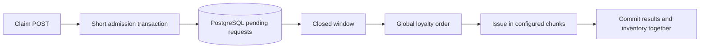

# Voucher Issuance Service

A Java 17 and Spring Boot 3 service for limited voucher campaigns. Requests enter a durable PostgreSQL queue. After each collection window closes, users with higher mocked loyalty scores receive the remaining vouchers first. Inventory is shared across all windows and application instances.

## Start from a fresh clone

Prerequisites on macOS or Linux:

- JDK 17 or newer compatible with Spring Boot 3.5; this project is tested with Java 17.
- Python 3.9 or newer, Make, and curl or wget.
- Internet access on the first run to download Maven, dependencies, and PostgreSQL binaries.

No global Maven, PostgreSQL installation, or Docker installation is required for the default workflow. PostgreSQL runs as a real local server process, not an in-memory database. Run as your normal user, because PostgreSQL refuses to initialize as root. On Windows, use WSL with the Linux prerequisites.

On Apple Silicon, use an ARM64 JDK. The load run described below passed on a native ARM64 JDK, while the older x86 Java 17 runtime under Rosetta hit timeouts. Both the wrapper and local launch scripts honor `JAVA_HOME`; select the same JDK in IntelliJ.

```bash
git clone <your-private-repository-url> voucher-issuance-service
cd voucher-issuance-service
make verify
```

`make verify` performs these steps in order:

1. Downloads the pinned Maven distribution through the committed wrapper and prepares local configuration.
2. Runs the integration suite against an isolated PostgreSQL 17.11 instance on a random port.
3. Starts the persistent development PostgreSQL server on `127.0.0.1:55432`.
4. Builds and starts the API on `http://127.0.0.1:8080` and waits for database-backed readiness.
5. Runs a live HTTP test: 20 competing users, five vouchers, global loyalty ranking within one window, and idempotent replay.

The command exits nonzero if a build, test, startup, or API assertion fails. The API and development database remain running after success. The first run takes longer because it downloads dependencies and native database binaries.

```bash
make status
curl --fail http://127.0.0.1:8080/actuator/health/readiness
make down
```

Stopping preserves the development database in `.local/postgres`. Tests use a separate temporary database and do not clear your development data.

## Daily commands

| Command | Behavior |
| --- | --- |
| `make setup` | Prepare local configuration, Maven dependencies, and the DB launcher classpath. |
| `make up` | Start the database and packaged API in the background; already running processes are reused. |
| `make run` | Start the database and run the API in the foreground. |
| `make restart` | Stop this project's processes, rebuild, and restart. Use after editing application code. |
| `make db-up` | Start only the managed PostgreSQL server. |
| `make db-down` | Stop this project's API and managed database, preserving data. |
| `make test` | Run the full verification build with isolated real-HTTP integration tests. |
| `make smoke` | Run API assertions against the already-running local application. |
| `make load` | Submit 5,000 users with at most 1,000 requests in flight and validate results. |
| `make load USERS=5000 CONCURRENCY=5000` | Request a full 5,000-client burst; requires sufficient file descriptors and machine resources. |
| `make logs` | Show recent development API and database logs. |
| `make down` | Stop owned processes; leave source files and database data intact. |
| `make idea` | Open `pom.xml` in IntelliJ IDEA Community on macOS. |

The management script tracks its own PIDs and verifies their command markers before stopping them. It does not stop unrelated Java or PostgreSQL processes. Keep builds within one checkout sequential; concurrent Maven builds share the same `target` directory.

## Develop in IntelliJ IDEA

1. Open this directory or `pom.xml` and import it as a Maven project.
2. Set Project SDK and Maven runner JDK to Java 17. Choose the Maven Wrapper for the project.
3. Run `make setup` and `make db-up` in the IDE terminal.
4. Run the `main` method in `com.aepsy.voucher.VoucherApplication`. Set the working directory to this repository root so `.local/application-local.properties` is loaded.
5. Run `ClaimApiIntegrationTest` from the test gutter or use `make test`. The tests launch their own PostgreSQL server automatically.

If an API instance from `make up` already occupies port 8080, stop it with `make down`, then run `make db-up` before launching in IntelliJ. An IDE run can be debugged normally without changing the database setup.

`api.http` contains campaign, claim, polling, and inventory requests for an editor with a compatible HTTP client. Select the `local` environment. Setup generates the private HTTP environment file with your random local admin password. In IntelliJ Community, the Makefile and curl commands work regardless of HTTP client availability.

## Configuration

```yaml
voucher:
  batching:
    window-ms: ${VOUCHER_BATCH_WINDOW_MS:500}
    processing-chunk-size: ${VOUCHER_BATCH_PROCESSING_CHUNK_SIZE:500}
```

| Environment variable | Default | Meaning |
| --- | --- | --- |
| `VOUCHER_BATCH_WINDOW_MS` | `500` | Default collection window for new campaigns, 100 to 10,000 ms. |
| `VOUCHER_BATCH_PROCESSING_CHUNK_SIZE` | `500` | Requests per processing chunk, 1 to 10,000. |
| `VOUCHER_ALLOCATION_SCAN_INTERVAL_MS` | `100` | Worker discovery interval. |
| `VOUCHER_ALLOCATION_WORKERS` | `2` | Workers per application instance, 1 to 32. |
| `DATABASE_POOL_SIZE` | `24` | Maximum connections per application instance. |
| `PORT` | `8080` | API port; set before first local setup. |
| `DB_PORT` | `55432` | Managed development database port; set before first local setup. |
| `VOUCHER_ADMIN_USERNAME` | `admin` | Admin HTTP Basic username. |
| `VOUCHER_ADMIN_PASSWORD` | none | Required admin password; local setup generates one. |
| `SERVER_ADDRESS` | `127.0.0.1` | API bind address. |

Invalid batching settings fail startup. An explicit `batchWindowMs` in campaign creation overrides the application default. The resolved window is stored in the campaign and remains fixed if the application default later changes. Chunk size is read once per allocation transaction.

**Chunk size controls database processing, not admission or early window closure.** With 20 requests, 12 vouchers, and chunk size 5, the top 12 win in chunks of 5, 5, and 2. The other eight are rejected. Every chunk commits in the same transaction; failure in any chunk rolls back the whole window.

To change batching settings for the local background app:

```bash
make down
VOUCHER_BATCH_WINDOW_MS=1000 VOUCHER_BATCH_PROCESSING_CHUNK_SIZE=100 make up
```

The admin password and development database connection are stored in ignored `.local/application-local.properties`. Your generated credentials are also available in ignored `.local/settings.json`; do not commit either file. Environment variables named `SPRING_DATASOURCE_URL`, `SPRING_DATASOURCE_USERNAME`, and `SPRING_DATASOURCE_PASSWORD` can override that local connection. Without the local properties file, the application also accepts `DATABASE_URL`, `DATABASE_USERNAME`, and `DATABASE_PASSWORD`.

Local PostgreSQL listens only on loopback and uses its embedded development launcher authentication defaults. Use a separately managed PostgreSQL deployment with proper credentials for deployment beyond local development.

## Try the API with curl

After `make up`, load your generated admin password into a shell variable:

```bash
ADMIN_PASSWORD=$(python3 -c 'import json; print(json.load(open(".local/settings.json"))["adminPassword"])')
```

Create a campaign; capacity is the total voucher supply, not a request batch size:

```bash
CAMPAIGN_ID=$(curl --fail --silent --show-error \
  -u "admin:$ADMIN_PASSWORD" \
  -H 'Content-Type: application/json' \
  -d "{\"code\":\"DEMO_$(date +%s)\",\"capacity\":5,\"batchWindowMs\":500}" \
  http://127.0.0.1:8080/api/v1/admin/campaigns \
  | python3 -c 'import json,sys; print(json.load(sys.stdin)["id"])')
```

Submit a claim. `202 Accepted` confirms that the request has committed, not that a voucher has been awarded:

```bash
curl --include --fail \
  -H 'Content-Type: application/json' \
  -d "{\"campaignId\":\"$CAMPAIGN_ID\",\"userId\":\"demo-user\"}" \
  http://127.0.0.1:8080/api/v1/claims
```

Copy `requestId` from the response and poll after the window closes:

```bash
curl --fail http://127.0.0.1:8080/api/v1/claims/REPLACE_WITH_REQUEST_ID
curl --fail -u "admin:$ADMIN_PASSWORD" \
  "http://127.0.0.1:8080/api/v1/admin/campaigns/$CAMPAIGN_ID"
```

Pending requests have `status: PENDING`. A winner has `status: ISSUED` and `voucherCode`. A loser has `status: REJECTED` and `reason: SOLD_OUT`. Repeating the same user and campaign returns the original request, including after expiry. A completed replay returns `200` with the existing result.

| Endpoint | Access | Success |
| --- | --- | --- |
| `POST /api/v1/admin/campaigns` | Admin Basic authentication | `201` with resolved campaign settings |
| `GET /api/v1/admin/campaigns/{id}` | Admin Basic authentication | `200` with inventory |
| `POST /api/v1/claims` | Public exercise endpoint | `202` pending or `200` terminal replay |
| `GET /api/v1/claims/{requestId}` | Public exercise endpoint | `200` with current result |
| `GET /actuator/health/readiness` | Public | `200` when the DB-backed application is ready |
| `GET /actuator/metrics/{name}` | Admin Basic authentication | `200` with metric values |

Errors use `code`, `message`, and `traceId`. Invalid fields return `400`; missing resources return `404`; a campaign that has not started or has ended returns `409`; database admission failures return retryable `503`. A rejected stored claim is still queried with `200`.

The public `userId` is mocked identity for the assignment. A real deployment must bind claims and result visibility to authenticated users. Clients cannot submit loyalty points; unknown JSON fields are rejected.

## Allocation and data integrity



The default collection window is 500 ms. Requests admitted to the same window compete by loyalty descending, acceptance time ascending, then UUID ascending. Earlier windows consume inventory before later windows. A high-scoring user in a later window cannot replace an already-issued voucher. Inventory never resets at a boundary.

The mock provider uses `CRC32(UTF-8 userId) % 10000`, unless a server-side `voucher.loyalty.points` map supplies a fixture score. The first committed request stores its score permanently. All instances must use the same mock configuration.

Admissions hold compatible `FOR SHARE` locks on an already committed batch row. The allocator holds `FOR NO KEY UPDATE` on the campaign and `FOR UPDATE` on its earliest open batch. It waits for in-flight admissions, reads a fresh database timestamp, and ranks through new `READ COMMITTED` statements. Future admissions cannot join an expired batch. The independently committed batch catalog prevents an earlier accepted cohort from being hidden from the allocator.

Unique constraints enforce one request and one voucher per user and campaign, plus unique voucher codes. Voucher inserts, terminal results, the guarded inventory counter, and batch completion share one transaction. There is no Redis dependency, alternate FIFO fallback, shared ten-request throttle, or in-memory-only acceptance path.

See [the full specification](docs/TECH_SPEC.md) for the protocol and implementation plan.

## Tests and load reports

The first Git commit contains the API tests before application code. The baseline failed because no application configuration existed. The implementation makes those HTTP contracts pass.

```bash
make test
make up
make smoke
make load USERS=5000 CONCURRENCY=1000
```

The suite uses real HTTP ports, real PostgreSQL 17.11, and no mocked service or repository behavior. It covers validation, admin access, same-window top-five priority, retries, capacity exhaustion, expiry, independent campaigns, and processing across chunks. Additional tests inject a database error after the first chunk to verify complete rollback and recovery, and start a second application context with a separate HTTP port to verify shared inventory.

Configuration tests verify that invalid window and chunk settings prevent startup. Tests configure known loyalty fixtures and assert that priority candidates share one batch; a client-side simultaneous send alone cannot prove that condition.

The live client retries transient connection failures and retryable `429` or `503` responses up to three times using the same user and campaign. Set `--max-retries 0` on `scripts/api_test.py` for a run without retries. It exits nonzero for an unrecovered request failure, duplicate vouchers, an incorrect issued count, incorrect same-cohort winners, or broken replay.

Load reports include final admission status counts, all attempt status/error counts, retried attempt counts, latency, elapsed time, and cohort counts. Admission HTTP percentiles describe the final successful attempts and exclude the client's semaphore wait and retry backoff; total admission duration includes the retries. Correctness passing does not imply a latency target has been achieved.

Reports:

- `target/surefire-reports/` contains JUnit results.
- `target/reports/api-20.json` contains the live priority demonstration.
- `target/reports/api-5000.json` contains the latest load run.
- [Verification results](docs/VERIFICATION.md) records the delivered run and its limits.

## Optional Docker PostgreSQL

Docker Compose is an alternative to the managed native server. Do not run both databases on the same host port.

```bash
make down
make setup
export DATABASE_PASSWORD='choose-a-local-database-password'
docker compose up -d --wait
./mvnw -DskipTests package
SPRING_DATASOURCE_PASSWORD="$DATABASE_PASSWORD" \
  java -jar target/voucher-issuance-service-1.0.0-SNAPSHOT.jar
```

Stop the API with Ctrl-C and run `docker compose down` to stop that database. Its named volume is retained. `make down` controls the native launcher, not Docker containers. Docker is optional and was not installed on the development machine used for the native workflow.

## Troubleshooting

- **Port already in use:** stop the process that you own, or set `PORT` and `DB_PORT` before the first setup in a fresh checkout. The selected local ports are stored in `.local/settings.json`.
- **Missing JDK or wrong language level:** select Java 17 in both your shell and IntelliJ's Maven runner. `java -version` and `./mvnw -version` show the active runtime.
- **Database startup failure:** inspect `.local/db.log`. The launcher explicitly initializes with locale `C` to avoid invalid shell locale settings. Run as a normal user.
- **API startup failure:** inspect `.local/app.log`; a blank admin password or invalid batching values fail startup.
- **Edited code does not appear:** run `make restart`; `make up` reuses an already running process.
- **Dependency download blocked:** the first run needs Maven Central access. Later runs use the Maven cache.
- **Pending claims:** check database-backed readiness and the allocation failure metrics. Accepted requests stay durable while a worker is stopped and are processed after it returns.

Keep the repository private as required by the assignment. Local credentials, database files, logs, IDE files, and generated reports are ignored by Git.

## Push the local repository to your GitHub account

Create an empty **private** GitHub repository without generating another README. From this project's directory, replace `YOUR_GITHUB_USER` with your account name:

```bash
git remote add origin https://github.com/YOUR_GITHUB_USER/voucher-issuance-service.git
git push -u origin main
```

The local project directory is already initialized and committed, so another `git init` or initial commit is unnecessary there. The downloadable source ZIP excludes Git metadata; if using that ZIP, run `git init -b main`, `git add .`, and `git commit -m "Initial version"` before adding the remote. If a remote already exists, inspect `git remote -v` before changing it; do not overwrite an unrelated remote or force-push.

Authenticate Git using your configured credential helper, an SSH key, or IntelliJ's GitHub integration. A browser sign-in alone does not authenticate command-line Git. If you use GitHub CLI, `gh auth login` followed by `gh auth setup-git` configures HTTPS credentials. No tokens or passwords belong in the source repository.
