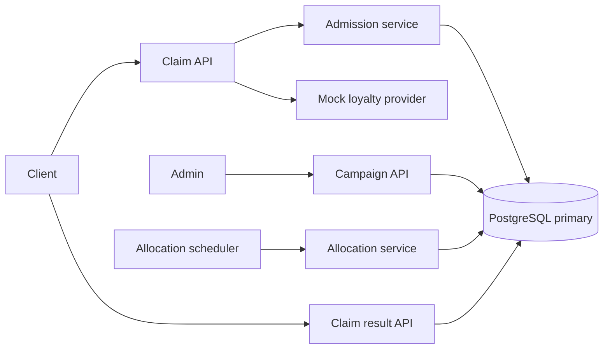

# Voucher Issuance Service Implementation Specification

Build a Spring Boot service that accepts voucher requests durably, groups competing requests into short time windows, and allocates limited inventory by loyalty score. PostgreSQL owns the queue, allocation results, and inventory. Implement the architecture below in the ordered steps in the implementation plan.

The campaign capacity is a lifetime limit. A window determines which requests compete together; it never replenishes inventory or limits the queue to the number of available vouchers.

## Architecture

### System components

Use one deployable application with HTTP endpoints and a background allocation worker. Multiple application instances may share one PostgreSQL primary. Correctness must come from database coordination rather than an in-memory queue or a scheduler running on only one instance.



| Component | Responsibility |
| --- | --- |
| Campaign service | Create immutable campaign configuration and validate its schedule. |
| Loyalty provider | Return a deterministic mocked score using server-controlled data. |
| Batch catalog | Find or create the committed row representing a time window. |
| Admission service | Persist one request per user and campaign in an eligible window. |
| Allocation scheduler | Discover due work and submit bounded allocation tasks. |
| Allocation service | Freeze a window, select winners, issue vouchers, and commit results atomically. |
| Claim query service | Return the durable pending or terminal result. |

Controllers handle HTTP validation and response mapping. Services own business rules and transaction boundaries. Repositories own explicit SQL. Avoid an interface for every class; introduce an interface where behavior actually varies, such as `LoyaltyProvider`.

### Technology choices

| Concern | Choice |
| --- | --- |
| Runtime | Java 17 |
| Application framework | Spring Boot 3.5.16, with dependency versions managed by its BOM |
| Database | PostgreSQL 17 with one authoritative writer |
| Persistence | Spring JDBC and explicit SQL for locking and bulk writes |
| Build | Maven with a committed Maven Wrapper |
| Schema changes | Flyway |
| API validation and administration | Jakarta Validation and Spring Security |
| Operations | Spring Boot Actuator and Micrometer |
| Tests | JUnit 5, Spring Boot Test, and Testcontainers with PostgreSQL |
| Local environment | Docker Compose |

Spring Boot 3.5 supports Java 17. Keep the implementation on the required 3.x line and pin dependency and container versions when adding the build. See [Spring Boot system requirements](https://docs.spring.io/spring-boot/3.5/system-requirements.html).

Redis and a message broker are outside the initial implementation. Every accepted claim must be stored in PostgreSQL, so an additional cache would not remove that write. There is one allocation path, with the same priority rules during normal operation and recovery.

### Batch configuration

Both the time window and processing chunk size are configurable through application properties and environment variables:

```yaml
voucher:
  batching:
    window-ms: ${VOUCHER_BATCH_WINDOW_MS:500}
    processing-chunk-size: ${VOUCHER_BATCH_PROCESSING_CHUNK_SIZE:500}
```

| Property | Default | Validation | Meaning |
| --- | --- | --- | --- |
| `voucher.batching.window-ms` | 500 ms | 100 to 10,000 ms | Default collection window for newly created campaigns. An explicit campaign `batchWindowMs` overrides this default. |
| `voucher.batching.processing-chunk-size` | 500 requests | 1 to 10,000 requests | Maximum number of requests handled in one selection and bulk-write chunk during allocation. |

Bind these settings to validated `@ConfigurationProperties`; invalid configuration fails application startup. Persist the resolved window duration in each campaign, so changing the application default does not move an existing campaign's boundaries. Processing chunk size is an operational setting shared by the allocation operations on an instance and read once at the start of each allocation transaction. Apply application configuration changes through restart in this version.

Processing chunk size does not close a collection window, cap the number of admitted users, or change campaign capacity. Every request in the closed window participates in the same loyalty ordering. Chunks control database work and memory use; they do not define separate groups of competing users.

For example, with 20 requests, 12 remaining vouchers, and chunk size 5, the worker issues to the globally ranked top 12 in chunks of 5, 5, and 2. It rejects the other 8 in chunks of 5 and 3. All chunks commit together. If fewer requests arrive than the configured chunk size, allocation still runs when the window closes.

### Business rules and window semantics

1. A campaign has a fixed positive capacity. Capacity and window configuration cannot change after creation in this version.
2. A user may have only one logical claim request and one issued voucher per campaign.
3. Use fixed, non-overlapping windows with the campaign's resolved `batchWindowMs`, defaulting to `voucher.batching.window-ms` at creation. The initial application default is 500 ms.
4. A window is the half-open interval `[opensAt, closesAt)`. A request admitted exactly at `closesAt` belongs to the next window, if the campaign remains open.
5. Window membership is determined when the database admission protocol accepts the request, not when a client sends it or when an HTTP handler begins running.
6. Within one window, rank by `loyaltyPointsSnapshot DESC`, then `acceptedAt ASC`, then `requestId ASC` using PostgreSQL UUID ordering.
7. Allocate windows with accepted requests in chronological order. A higher score in a later window cannot displace a voucher issued by an earlier window.
8. Wait until the window closes before allocating, even if enough requests have arrived to consume all remaining inventory.
9. Store loyalty at first successful admission. A retry cannot change the score, timestamp, or window.
10. Requests accepted before campaign end remain eligible for processing after campaign end.

For capacity 5 and 20 users admitted into one window, all 20 wait and the five highest scores win. The remaining 15 receive `SOLD_OUT`. Every later user also receives `SOLD_OUT` because remaining inventory is zero. For capacity 5,000 and only 100 requests in a window, all 100 win and 4,900 remain.

This definition makes priority testable within a window. Requests separated by a window boundary do not compete together, even if the client send times are close. Global loyalty ranking across an entire campaign would require waiting until registration ends and is outside the chosen behavior.

### Window calculation and authoritative time

Store timestamps as `timestamptz` and serialize them as UTC ISO 8601 values. Use the PostgreSQL primary as the time authority.

```text
sequenceNo = floor((admissionTime - campaign.startsAt) / windowDuration)
opensAt    = campaign.startsAt + sequenceNo * windowDuration
closesAt   = min(opensAt + windowDuration, campaign.endsAt)
```

Use integer duration arithmetic so floating point rounding cannot move a boundary. Windows without requests need no persistent rows.

After waiting for a database lock, obtain a fresh `clock_timestamp()` in a subsequent statement and revalidate eligibility. PostgreSQL `CURRENT_TIMESTAMP` and `now()` represent transaction start time, while `clock_timestamp()` returns current wall time. See [PostgreSQL date and time functions](https://www.postgresql.org/docs/17/functions-datetime.html#FUNCTIONS-DATETIME-CURRENT).

### Data model

Use UUID primary keys. User IDs are case-sensitive opaque strings of 1 to 128 characters; reject leading or trailing whitespace rather than silently changing an identity. Campaign codes must match `^[A-Z][A-Z0-9_]{0,63}$`.

| Table | Columns |
| --- | --- |
| `campaign` | `id`, `code`, `capacity`, `issued_count`, `batch_window_ms`, `starts_at`, `ends_at`, `created_at` |
| `claim_batch` | `id`, `campaign_id`, `sequence_no`, `opens_at`, `closes_at`, `status`, `completed_at` |
| `claim_request` | `id`, `campaign_id`, `user_id`, `batch_id`, `loyalty_points_snapshot`, `accepted_at`, `status`, `rejection_reason`, `resolved_at` |
| `voucher` | `id`, `campaign_id`, `user_id`, `claim_request_id`, `code`, `issued_at` |

Use `integer` for capacity and issued count, and `bigint` for loyalty points and sequence numbers. Store voucher codes in `varchar(128)`. All columns are non-null except `completed_at`, `rejection_reason`, and `resolved_at`, whose nullability follows the state rules below. Default `issued_count` to zero. Reject negative loyalty scores from the mock fixture.

Required database constraints:

- `campaign`: unique `code`; `capacity > 0`; `0 <= issued_count <= capacity`; `ends_at > starts_at`; window duration in the supported range.
- `claim_batch`: foreign key to campaign; unique `(campaign_id, sequence_no)`; unique `(id, campaign_id)` for the composite reference below; `sequence_no >= 0`; `opens_at < closes_at`.
- `claim_request`: unique `(campaign_id, user_id)`; composite foreign key `(batch_id, campaign_id)` to `claim_batch(id, campaign_id)`; unique `(id, campaign_id, user_id)` for the voucher reference; nonnegative loyalty.
- `voucher`: unique `code`; unique `claim_request_id`; unique `(campaign_id, user_id)`; composite foreign key `(claim_request_id, campaign_id, user_id)` to the matching request.
- Enforce enum values with check constraints. For a pending request, result fields are null. An issued request has `resolved_at` and no rejection reason. A rejected request has both `resolved_at` and reason `SOLD_OUT`.
- A completed batch has `completed_at`; an open batch does not. Use restrictive deletion behavior; automatic deletion is outside scope.

States:

```text
claim_request: PENDING -> ISSUED
                      -> REJECTED with reason SOLD_OUT

claim_batch:   OPEN -> COMPLETED
```

`OPEN` means not yet allocated. Admission additionally checks the deadline, so an expired open batch never accepts a new request. The allocation transaction holds the batch lock while freezing and processing its membership; a separately committed `PROCESSING` or `SEALED` state is unnecessary.

Required indexes, in addition to those backing constraints:

```sql
CREATE INDEX claim_batch_due_idx
    ON claim_batch (closes_at, campaign_id)
    WHERE status = 'OPEN';

CREATE INDEX claim_batch_open_order_idx
    ON claim_batch (campaign_id, sequence_no)
    WHERE status = 'OPEN';

CREATE INDEX claim_request_pending_rank_idx
    ON claim_request
       (batch_id, loyalty_points_snapshot DESC, accepted_at ASC, id ASC)
    WHERE status = 'PENDING';
```

Do not create all voucher codes or all empty windows in advance. Generate voucher codes only for selected winners using random UUIDs with an optional campaign prefix. The unique constraint remains the final collision guard.

### Transaction and locking protocol

Use `READ COMMITTED` explicitly for admission and allocation. Keep external calls, backoff, HTTP waiting, and window timers outside transactions.

The chosen lock protocol uses concurrent `FOR SHARE` locks for admissions to a batch and `FOR UPDATE` for allocation of that batch. Allocators serialize on the campaign with `FOR NO KEY UPDATE`. This campaign lock also allows foreign key checks using `FOR KEY SHARE` to proceed; replacing it with `FOR UPDATE` can create avoidable contention and lock cycles. See [PostgreSQL row locking](https://www.postgresql.org/docs/17/explicit-locking.html#LOCKING-ROWS).

#### Admission protocol

`ClaimSubmissionService` coordinates the following sequence without wrapping the whole sequence in a transaction:

1. Validate input and look up an existing `(campaignId, userId)` on the primary. If found, return it, including after campaign expiry or inventory exhaustion.
2. Load immutable campaign configuration. Reject an unknown or currently ineligible campaign. Resolve the server-controlled mock loyalty score outside a write transaction.
3. Calculate a candidate window using DB time. `BatchCatalogService` finds its row, or inserts it using `ON CONFLICT (campaign_id, sequence_no) DO NOTHING` in a separate short transaction.
4. Ensure that batch row is committed before starting the request admission transaction. Existing committed batch rows need no creation transaction.
5. Call `ClaimAdmissionService.admitOneWindow` through a separate transactional bean. Recheck the existing logical request, then lock the selected batch with `FOR SHARE`.
6. Read fresh DB time after obtaining the lock. Verify `status = OPEN`, `opens_at <= time < closes_at`, and campaign eligibility. If the candidate expired, end this transaction and recalculate the current window. Never backdate admission to the expired window.
7. Insert `PENDING` with the snapshot score and the validated DB timestamp. Use `ON CONFLICT (campaign_id, user_id) DO NOTHING RETURNING ...`.
8. If another concurrent submission created the logical request, load it with a subsequent SQL statement and return that row. Do not overwrite its values.
9. Commit before sending `202 Accepted`.

The separate batch creation commit is mandatory. Otherwise an uncommitted earlier batch could contain an admission while remaining invisible to a worker selecting a later batch. Here, every eligible admission holds a lock on an already visible batch row, so a due worker can find that cohort and wait for its admissions to commit.

An admission may validate just before the deadline and commit just after it. It belongs to the original batch because the worker must wait for its shared lock. A request whose validation occurs after the deadline must move forward, regardless of when its HTTP request arrived.

Limit window rollover retries to three fresh transactions and return retryable `503` if the submission cannot complete. Transient database retries also use a bounded policy outside the failed transaction. The same user and campaign identify the operation across retries.

#### Allocation protocol

`AllocationScheduler` discovers campaign IDs with expired open batches. For each candidate, call a separate `BatchAllocationService.allocateNextBatch` bean. Each invocation processes one batch in one transaction:

```text
BEGIN with READ COMMITTED

1. SELECT the campaign FOR NO KEY UPDATE SKIP LOCKED.
   If another allocator owns it, skip this campaign for this scheduler pass.

2. In a fresh statement, SELECT its earliest OPEN batch
   ORDER BY sequence_no ASC LIMIT 1 FOR UPDATE.
   Do not use SKIP LOCKED here.

3. Read fresh DB time after the batch lock is acquired.
   If the batch is not due, finish without allocating.

4. Read remaining = capacity - issued_count from the locked campaign.

5. Read processingChunkSize from configuration once. Establish one global
   ordering over all PENDING requests in the locked, closed batch:
   ORDER BY loyalty_points_snapshot DESC, accepted_at ASC, id ASC.

6. While remaining > 0, select the next highest-ranked PENDING requests
   from that entire cohort with LIMIT min(processingChunkSize, remaining).
   Generate codes, bulk insert their vouchers, and mark them ISSUED.
   Decrease remaining by the actual inserted count and accumulate winnerCount.
   Stop if no PENDING requests remain.

7. Set resolved_at for winners as part of their chunk updates.

8. Select any remaining PENDING requests in chunks of processingChunkSize
   and mark them REJECTED / SOLD_OUT with resolved_at until none remain.

9. Increment issued_count by the actual number of inserted vouchers
   with a guard that issued_count + winnerCount <= capacity.

10. Mark the batch COMPLETED and set completed_at.

COMMIT
```

After waiting for admissions, the ranking query must be a new statement, rather than part of the statement that acquired the batch lock. Under PostgreSQL `READ COMMITTED`, a new statement sees transactions committed before that statement starts. See [PostgreSQL transaction isolation](https://www.postgresql.org/docs/17/transaction-iso.html#XACT-READ-COMMITTED).

Use bulk JDBC operations or set-based SQL. Every winner query applies the global priority order to all remaining pending requests in the closed cohort before applying its chunk limit. Never split by arrival order or arbitrary pages and rank each page independently. Do not use `SKIP LOCKED` on claim candidates: it could bypass a higher-scoring request.

Keep the campaign and batch locks until every chunk has finished and the transaction commits. Do not commit individual chunks or let another window run between them. A failure after any chunk rolls back all chunks, request states, voucher inserts, and counter changes. Smaller chunks bound each operation's size; they do not shorten the overall transaction or reduce its total locked rows.

Verify affected row counts. On an unexpected constraint violation, inconsistent state, or failed guarded counter update, roll back the entire transaction. Do not silently ignore a failed winner insert and consume capacity anyway. A random code collision may regenerate codes on a bounded full-transaction retry while preserving the winner order.

#### Correctness conditions

| Invariant | Enforcement |
| --- | --- |
| Issued vouchers never exceed campaign capacity | Campaign lock, remaining calculation, guarded counter update, atomic commit. |
| A user gets at most one voucher per campaign | Unique constraints on requests and vouchers. |
| Winners are the highest-ranked eligible requests in a closed cohort | Deadline validation, exclusive batch lock, fresh ranking statement. |
| A later accepted cohort cannot consume inventory ahead of an earlier one | Committed batch catalog, earliest-open selection, campaign allocation lock. |
| Retrying an accepted request never creates another chance | Stable natural key `(campaign_id, user_id)` and immutable admission values. |
| No partial issuance survives a crash | Vouchers, request results, counter, and batch completion commit together. |

For each campaign after committed allocation, `issued_count` must equal the number of voucher rows. A counter check constraint alone does not establish this cross-table equality; all voucher writes must use the allocation service.

### API contracts

#### Create a campaign

`POST /api/v1/admin/campaigns` requires an admin credential configured through environment variables. Do not commit credentials.

```json
{
  "code": "MENTAL_HEALTH_DAY",
  "capacity": 5000,
  "batchWindowMs": 500,
  "startsAt": "2026-10-20T00:00:00Z",
  "endsAt": "2026-10-21T00:00:00Z"
}
```

If `batchWindowMs` is omitted, resolve it from `voucher.batching.window-ms` and persist the value. The example uses the initial default of 500 ms. `processingChunkSize` is an application setting and is not accepted from a claim or campaign request. If omitted, `startsAt` defaults to creation time at the DB and `endsAt` defaults to 24 hours after the resolved start time. Explicit schedules must end after they start and after creation time.

Return `201 Created` with the campaign ID and resolved configuration. A duplicate code returns `409 CAMPAIGN_CODE_EXISTS`. Expose `GET /api/v1/admin/campaigns/{campaignId}` for inventory and configuration inspection.

#### Submit a claim

`POST /api/v1/claims`

```json
{
  "userId": "user-123",
  "campaignId": "8ae64d72-3e0e-4ae6-a095-62fef045690b"
}
```

After admission commits:

```http
HTTP/1.1 202 Accepted
Location: /api/v1/claims/5aac0e20-094a-419c-a383-d71b328da50f
Retry-After: 1
```

```json
{
  "requestId": "5aac0e20-094a-419c-a383-d71b328da50f",
  "campaignId": "8ae64d72-3e0e-4ae6-a095-62fef045690b",
  "batchId": "1c8894ac-8f04-48c8-8dea-f9387d599e60",
  "status": "PENDING"
}
```

The same user and campaign always return the same `requestId`. Return `202` if the observed result is pending, or `200` with its terminal result. No separate idempotency key is needed for this one-operation-per-user contract. A changed client key must never bypass the database uniqueness rule.

For the initial implementation, new requests submitted while the campaign is active still enter the current window even if inventory is already exhausted; the worker records their durable `REJECTED / SOLD_OUT` result after closure. This keeps one result flow. A synchronous sold-out optimization is deferred.

#### Query a claim

`GET /api/v1/claims/{requestId}` returns `200` with the current state:

```json
{
  "requestId": "5aac0e20-094a-419c-a383-d71b328da50f",
  "status": "ISSUED",
  "voucherCode": "MH-8f21884b817844919cff849f0bf9a18d"
}
```

A rejected result has `status: "REJECTED"` and `reason: "SOLD_OUT"`. A pending result has no voucher code or rejection reason. Use the primary for result reads in this version.

#### Errors and identity scope

| HTTP status | Error code or behavior |
| --- | --- |
| `400` | `INVALID_REQUEST` for malformed IDs or invalid fields |
| `401` or `403` | Missing admin authentication or insufficient admin permission |
| `404` | `CAMPAIGN_NOT_FOUND` or `CLAIM_NOT_FOUND` |
| `409` | `CAMPAIGN_NOT_STARTED`, `CAMPAIGN_ENDED`, or duplicate campaign code |
| `429` | Optional per-user throttling, if explicitly enabled later |
| `503` | `SERVICE_UNAVAILABLE` for admission overload or unavailable database; retry the same logical request |

Return errors with `code`, `message`, and `traceId`, without stack traces or secrets. `GET` of a rejected claim still returns `200` because the result exists.

The exercise accepts a supplied user ID on the public claim endpoint. That identifier is mocked identity, not authentication. Binding claims and result access to an authenticated identity is a separate production extension; do not claim this demo prevents impersonation.

### Recovery and operational behavior

| Failure | Required behavior |
| --- | --- |
| API stops before commit | No accepted request exists; client retries. |
| Commit succeeds but the response is lost | Retry finds the original request and result. |
| Commit outcome is unknown after a network failure | Do not report issuance or acceptance as certain; retry using the same user and campaign. |
| Worker fails during allocation | PostgreSQL rolls back all allocation changes; another pass retries. |
| Worker fails after commit | Completed state and voucher remain durable; no reissuance. |
| All workers stop | Requests remain pending; restarted workers drain due batches. |
| PostgreSQL is unavailable | Return `503`; never acknowledge an in-memory-only request. |
| Mock loyalty data is unavailable or invalid | Fail admission; do not silently assign zero points. |

Use short configured statement and lock timeouts and retry failed transactions from outside their transaction boundary. Cap retries and back off with jitter. A scheduler failure must be logged and counted without stopping future scheduler passes.

No time-based claim rate limit is enabled by default in the exercise. In particular, do not configure a shared 10-requests-per-30-seconds bucket. Use bounded HTTP work, connection pools, and worker concurrency to protect resources. Overload rejection occurs before a request is acknowledged as accepted. Future throttling must be per user or campaign and must not replace priority selection.

Start the scheduler with a configurable 100 ms scan interval and two allocation workers. Submit bounded work and avoid enqueuing repeated tasks for a busy campaign in local memory. Local deduplication is an efficiency measure; the DB lock remains the coordination mechanism across instances. Size the total connection pools of all instances against the actual PostgreSQL connection budget.

Record submission latency, allocation duration, pending count, oldest pending age, duplicate submissions, committed issued count, retries, errors, lock waits, and connection pool saturation. Keep user IDs and request IDs out of metric labels. Include IDs in structured logs for tracing; do not log voucher codes or credentials.

Provide health and readiness checks. DB failure makes readiness fail. Alert on pending age exceeding the normal processing range, repeated worker failures, or inventory reconciliation mismatch.

### Performance targets and boundaries

The initial load profile is 5,000 concurrent clients each submitting one claim, followed by polling at most once per second. These are implementation targets to measure on documented hardware:

| Measure | Target |
| --- | --- |
| Duplicate vouchers or oversell | Zero |
| Incorrect winner order within the same batch | Zero |
| Claim admission latency within the demonstrated capacity envelope | p95 below 300 ms |
| End-to-end result latency within that envelope | p95 below 2 seconds with a 500 ms window |
| Accepted claims lost after process restart | Zero with PostgreSQL durable commits enabled |

Report actual throughput, errors, queue age, and latency together. Do not present a low latency obtained by rejecting most requests as a successful capacity result. Load-driven queuing can push submissions into later windows because admission time defines membership.

The initial scope excludes email delivery, voucher redemption, capacity changes, claim cancellation, cross-region active writers, and global loyalty ranking across the full campaign. A broker or cache can be considered only after measurements identify a bottleneck and the replacement preserves the same acceptance and allocation semantics.

## Implementation plan

Complete these steps in order. Keep each step runnable and reviewable before starting the next.

### Step 1 Bootstrap the application

Add `pom.xml`, Maven Wrapper, the Spring Boot entry point, Docker Compose for PostgreSQL, and an environment example. Extend the provided batching configuration in `application.yml` with database and operational settings. Bind and validate both window duration and processing chunk size. Include web, validation, JDBC, security, Flyway PostgreSQL support, Actuator, and test dependencies. Pin versions without overriding the Spring BOM unnecessarily.

Use the existing package directories under `com.aepsy.voucher`. Configure secrets through environment variables. Create local, test, and load-test settings as needed without embedding passwords intended for deployment.

**Completion:** the application starts with PostgreSQL, health reports correctly, and `./mvnw verify` runs. Environment overrides work for both batching settings and invalid values fail startup. No claim behavior is required yet.

### Step 2 Add schema and repository primitives

Create the first Flyway migration for all four tables, constraints, and indexes. Add explicit repository methods for campaign creation, committed batch lookup, batch creation, shared admission locking, ordered candidate selection, and bulk updates. Add DB time access used by the protocol.

**Completion:** migrations run on an empty PostgreSQL container and a second startup succeeds without schema changes. Integration tests verify uniqueness, composite references, and capacity checks. Do not use H2 to validate locking behavior.

### Step 3 Implement campaign APIs and mocked loyalty

Add campaign creation and inspection endpoints with input validation and admin protection. Implement schedule defaults. Implement deterministic loyalty fixtures so known users receive known scores; provide a deterministic nonnegative default function for users absent from fixtures. The provider never accepts a score from the request.

**Completion:** a minimal campaign can be created; duplicate codes and invalid capacities fail predictably; repeated score lookup for the same user returns the same value across instances using the same configuration.

### Step 4 Implement durable admission and result lookup

Implement the batch formula, independently committed batch catalog, transactional single-window admission, and bounded rollover retries. Add the submit and result endpoints with the exact replay behavior above. Keep the scheduler disabled in these tests so pending state can be inspected.

**Completion:** parallel submissions for the same user and campaign produce exactly one logical request. Different users persist independently. Client retries after campaign end retrieve the existing request. Requests validated after a boundary cannot enter the expired batch.

### Step 5 Implement allocation without automatic scheduling

Implement `BatchAllocationService.allocateNextBatch` as a separate Spring bean. Add campaign and batch locks, globally ordered chunk selection, code generation, bulk issuance, terminal results, and the guarded inventory update. Use the configured chunk size for winner and rejection processing while retaining one transaction for the entire window. Invoke it directly in integration tests before connecting the scheduler.

Spring transactional methods must be called through the transactional bean, not by self-invocation in the same class. See [Spring transaction proxy behavior](https://docs.spring.io/spring-framework/reference/data-access/transaction/declarative/annotations.html).

**Completion:** 20 distinct users in one closed batch with capacity 5 yield exactly the top five scores, five vouchers, 15 rejected requests, and `issued_count = 5`. The result is identical for chunk sizes 1, 5, and 100. Calling allocation again changes nothing.

### Step 6 Add scheduling and recovery

Connect the bounded scheduler, due-work discovery, and worker executor. Process one batch per transaction; continue in later passes when more work exists. Add graceful shutdown that stops scheduling, gives active transactions a bounded opportunity to finish, and allows rollback on interruption.

**Completion:** two application instances can submit and allocate against the same database. Workers recover pending work after restart, and an earlier cohort cannot be overtaken by a later one. No leader election or distributed scheduler lock is required.

### Step 7 Prove concurrency and rollback behavior

Use real PostgreSQL with independent connections and coordinated latches. Test the interleavings in the acceptance matrix below. For rollback tests, inject a controlled exception after voucher insertion and before commit. For process recovery, stop a worker process while it owns an allocation transaction and resume with another process.

For same-window API tests, configure a longer test window, submit the cohort well before the cutoff, and assert all responses reference the same batch. Use bounded polling or explicit coordination instead of arbitrary sleeps. Test the default 500 ms timing and alternate configured durations separately. Repeat priority tests with multiple chunk sizes and inject a failure after an intermediate chunk to prove the whole window rolls back. A client-side barrier alone does not prove that every request was admitted into the same batch.

**Completion:** invariants pass repeatedly under multiple submitters and allocators, including the admission-versus-closing race. Expected transient retries do not create extra requests or vouchers.

### Step 8 Measure load and add operational controls

Add a reproducible load script for a 20-user priority example, a 5,000-client burst, duplicate storms, and sustained polling. Record hardware, both batching settings, other configuration, dataset, batch distribution, throughput, HTTP errors, allocation latency, and DB saturation. Tune processing chunk size, pool sizes, and executor limits using those results.

Add the metrics and health behavior defined above. Verify overload produces explicit retryable responses rather than lost acknowledged requests. If performance targets are missed, document the measured bottleneck before adding infrastructure.

**Completion:** a saved benchmark report contains actual numbers and invariant queries after each run. The default claim endpoint has no shared time-based throttle.

### Step 9 Complete the handoff

Update README with prerequisites, local startup, admin credentials setup, both batching settings and their environment variables, request and polling examples, tests, load commands, window semantics, and measured limits. Include a diagram and a short explanation of the locks. Keep the repository private or deliver a source archive as the assignment requires.

**Completion:** a fresh checkout can start the service and reproduce the priority demonstration using only the documented commands. All required tests pass with `./mvnw verify`.

## Acceptance matrix

| Scenario | Expected result |
| --- | --- |
| 20 unique users, capacity 5, one cohort | Exactly the five highest-ranked users win. |
| Same cohort with processing chunk sizes 1, 5, and 100 | Identical winners and terminal results for every chunk size. |
| 20 requests, 12 vouchers, chunk size 5 | Top 12 win across three issuance chunks; remaining 8 are rejected. |
| Fewer requests than processing chunk size | Window closes on time and all requests are processed. |
| Alternate configured window duration | New campaigns use the configured default; explicit campaign overrides still work. |
| Application default changes after campaign creation | Existing campaign windows retain their persisted duration. |
| Invalid window duration or processing chunk size | Configuration validation fails startup. |
| Equal scores | Acceptance timestamp, then request UUID, decide deterministically. |
| 5,000 unique users, capacity 5,000 | All valid accepted users win; allocation may span windows. |
| More accepted users than capacity | Total voucher count equals capacity; remaining requests resolve sold out. |
| 100 concurrent retries by one user | One request ID and at most one voucher. |
| One user in two campaigns | One independent claim is allowed in each campaign. |
| First cohort consumes all inventory | Every later cohort is rejected; capacity never resets. |
| First cohort has low scores, next cohort has higher scores | Earlier committed awards remain; later users compete only for remaining inventory. |
| Allocation invoked before cutoff | No voucher is issued early. |
| Admission holds a batch share lock before cutoff and commits after cutoff | Worker waits and ranks that committed request. |
| Admission acquires its lock after cutoff | It retries against the current eligible window. |
| A candidate batch has not committed yet | No claim can be admitted to it until catalog commit; a later cohort cannot overtake an eligible hidden admission. |
| Two workers target the same campaign | Only one allocates at a time. |
| Worker fails after some writes but before commit | No partial result survives; retry allocates normally. |
| Worker fails after an intermediate processing chunk | Every chunk rolls back; no partial cohort allocation is visible. |
| Response lost after admission commit | Replay returns the original request. |
| Campaign expires while requests remain pending | Already accepted requests still receive results. |
| DB unavailable during submission | No false `202`; retryable error is returned. |

After each successful allocation or completed load run, verify:

```text
voucher count per campaign <= capacity
issued_count = voucher count per campaign
no duplicate (campaign_id, user_id) in voucher
every ISSUED request has exactly one matching voucher
every voucher belongs to an ISSUED request with matching campaign and user
COMPLETED batches contain no PENDING requests
within each batch, the issued set equals the expected top min(remainingBeforeBatch, cohortSize)
```

The implementation is complete when these checks, the API contract tests, concurrency tests, recovery tests, and documented startup workflow all pass. Performance claims must match the recorded benchmark environment.
